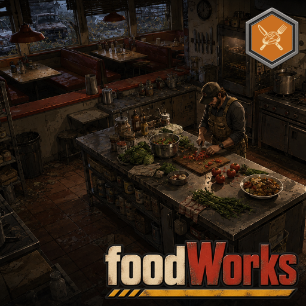

# B47ANCE’d Provisions

B47ANCE’d Provisions (formerly foodWorks) provides food inspection, preservation
and food-system foundations for theWorks ecosystem, using vanilla Build 42 food,
inventory and entity-resource systems.

- Status: version `0.8.0-dev.3` implements server-owned in-place drying for 22 vanilla fruit types. Offline tests pass; native SP and dedicated multiplayer NOT TESTED. Sweet preserves, pickling, curing and fermentation remain blocked. Development build, not a stable release.
- Mod ID: `B47ANCEDProvisions`; Workshop item: `3788591331`.
- Author: B47ANCE; hard mod dependencies: none.
- Source: [B47ANCE/B47ANCEDProvisions](https://github.com/B47ANCE/B47ANCEDProvisions) (public).

## Fruit drying

Carry a whole fresh supported fruit in your main inventory, stand beside an empty native
small-plant drying rack, and choose **Dry [fruit]**. One start action is offered per
supported type found in the bounded scan. Check progress, cancel to recover the actual aged fruit, or collect
the dried result. The server validates the actor, exact item, rack, access and
settings, using a private ledger rather than trusting public item metadata. Defaults: 48 observed loaded game hours and a sixfold shelf-life factor.
Unloaded racks and long observation gaps pause progress; food still ages. Carried
unfinished batches can return to an empty rack without receiving credit for carried time.

Completion changes the **same item**, preserving its ID, calories, macronutrients
and hunger. Weight becomes one quarter; thirst benefit becomes zero. Age and both
freshness thresholds scale together, so old food is not refreshed. Poisoned,
tainted, frozen, cooked, partly eaten, modified or unsupported inputs are rejected.

Each output retains its original vanilla type and appearance, with a localized
dried name (for example `Base.Apple` named **Dried apple slices** or `Base.Grapes`
named **Raisins**). No new item type or native recipe is registered. This
avoids the native recipe's post-output callback and a second consume/create
transaction. Vanilla/other mods still recognize each original base type; see
[behavior, configuration and limits](docs/APPLE_DRYING.md).

Supported types and the [149-item preservation catalog](docs/PRESERVATION_CATALOG.csv)
are documented in the [expansion plan and evidence](docs/PRESERVATION_EXPANSION.md).
Jam, jelly, marmalade, fruit butter, pickling, salting/smoking and fermentation
are separate planned processes. Multi-input nutrient accounting and heated/sealed
holder authority are unresolved; those recipes are not enabled or offered in menus.

Original [dried-apple inventory art](assets/dried-apple/README.md) is available as
a transparent master and 64×64 PNG export. Runtime texture hookup is pending;
the prototype still displays the vanilla apple icon. A matching
[original Blender model](assets/dried-apple/model/README.md) includes a textured
FBX and editable source; in-game model selection/display remains pending.

`foodWorks.EnableFruitDrying`, `foodWorks.FruitDryingHours` (integer 6–168) and
`foodWorks.FruitDryingShelfLifeMultiplier` (integer 1–12) are server-authoritative
sandbox settings. Existing jobs keep their accepted settings. No power, water,
weather, fuel or uiWorks dependency is added.

## Existing foundations

- Right-click one food to **Inspect Food State**, controlled by
  `foodWorks.EnableFoodInspection`.
- The independent read-only apple/rack preview remains available through
  `foodWorks.EnableFruitDryingPreview`; its unknown states do not authorize gameplay.
- Food adapters and ingredient classification expose normalized vanilla state.
- `ApplianceTransactions` and `PreservationProcesses` remain engine-independent
  foundations. The in-place process does not use their timers or change their contracts.
- Planned integrations: farmWorks, animalWorks, waterWorks, powerWorks,
  weatherWorks and uiWorks. No extra mod is required for this drying slice.

The [original design](docs/FRUIT_DRYING_DESIGN.md), [native-hook audit](docs/FRUIT_DRYING_NATIVE_HOOKS.md)
and [current source evidence](docs/APPLE_DRYING_EVIDENCE.json) distinguish historical
proposals from the implemented Lua alternative. The broader research is retained
in [B42 API research](docs/B42_API_RESEARCH_HANDOFF.md) and [roadmap](docs/MASTER_ROADMAP.md).

## Identity, source and validation

Use Mod ID `B47ANCEDProvisions`, replacing the old enabled `foodWorks` identity;
do not enable both. Workshop identity is unchanged. Legacy `foodWorks` Lua/API,
module paths, sandbox identifiers and existing save keys remain compatible. The
new job/index keys have their own v1 schema. Existing-save/native join compatibility
and downgrade behavior still require testing; preserve backups.

Authoritative source: `Contents/mods/B47ANCEDProvisions`; canonical version: root
`VERSION`, with mirrors in `version-inventory.json`. See [architecture](docs/ARCHITECTURE.md),
[versioning](docs/VERSIONING.md), [testing](docs/TESTING.md) and [rename](docs/IDENTITY_MIGRATION.md).
Current checks cover offline Lua 5.1, source fingerprints and static native
persistence/sync paths. They do not prove game behavior or native crash ordering.
G7 BLOCKED / NOT TESTED; stable G8 BLOCKED.

No current package, deployment, game/server launch or Workshop publication is
claimed. Historical archives/evidence retain their original versions.
